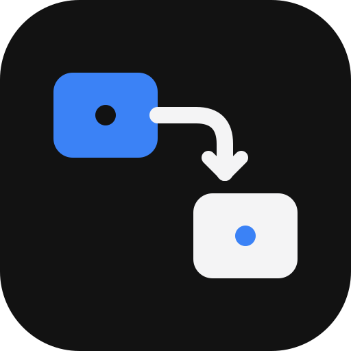

<p align="center"></p>

# Knotleaf Desk

An open-source, local-first whiteboard and visual notebook. Draw diagrams, connect ideas, and keep project notes in one place. Use it directly in your browser on Linux, Windows, macOS, or mobile. No account, database, subscription, or API key is required for core features.

## Features

- **Attached connectors:** magnetic top/right/bottom/left ports, visible connection placeholders, straight/curved/elbow routing, editable labels, endpoint caps and animated flow. Select a straight arrow and drag its center diamond to bend it, or enter a signed Bend (px) value in Appearance settings. Choose Straight to reset. Elbow paths respect both attachment directions and avoid their connected shapes. Move or resize shapes and the endpoints follow their exact ports, preserving custom curves. Dragging an arrow body preserves attachments; drag an endpoint to reconnect or detach it.
- **Connect without dragging:** select shapes in sequence with Shift, then choose **Connect selected**. Multi-selection also offers Align left, Align top and Space evenly.
- **Smart guides:** temporary red edge/center alignment lines, nearby gap measurements and equal-spacing indicators while dragging. Hold Alt to bypass magnetic alignment. Guides never appear in exports or saved projects.
- **Canvas text:** double-click empty space or inside a shape to write at the pointer, or choose Text (T) then click. Text written inside shapes follows their movement and resizing; double-clicking existing text places the caret near the clicked character. Text appears directly on the canvas with a transparent, borderless editor. Font, size, color, alignment and formatting controls update the active editor; Ctrl/Cmd+Enter finishes editing.
- **Resize and connect:** select an element, then drag a corner square or an edge beside a connector dot to resize. Drag the circular side dot to create a connection. Select mode shows ports only on the selected item; the Arrow tool reveals target ports. Text and freehand drawings resize their content, and Escape cancels an unfinished drag.
- **Canvas tools:** rectangles, diamonds, ellipses, freehand, text, sticky notes, frames, document cards, eraser, a disappearing red teaching highlighter (J), grid/snap, pan/zoom, undo/redo, duplication, resizing, layers and presentation mode.
- **Sized canvas text:** choose Text (T), then drag a writing area like a rectangle (Shift makes it square). Text wraps to the chosen width and grows vertically; resizing the box preserves font size. A click still starts automatic-size text.
- **Notes beside drawings:** Canvas / Split / Notes views. Drag the split divider, use arrow keys when it is focused, or double-click to reset. On narrow screens the split stacks vertically. Long notes scroll vertically; text and code wrap to avoid horizontal scrollbars.
- **Visual notebook:** write normally with headings, bold/italic/strikethrough, bullet and numbered lists, interactive checklists, sticky-note blocks, code, links, tables, dividers, find/replace, outline and undo/redo. Use buttons or familiar shortcuts without writing Markdown syntax. Optional Markdown source and `.md` downloads remain available. Existing notes open visually without changing their saved content.
- **Local workspaces:** create workspaces, organize/move boards, search, duplicate, import, and confirm deletion. Existing boards remain in Personal workspace. Workspaces are local folders rather than cloud teams.
- **Architecture library:** bundled cloud, database, language and infrastructure glyphs; optional online Iconify search; diagram templates.
- **Board tools:** Ctrl/Cmd+F searches canvas text, labels, icons, frame titles and Markdown notes. The same panel contains local version history and reusable custom templates. Restore/template actions create new boards; template and checkpoint downloads use `.knotleaf`.
- **Presentations:** frame-by-frame slides with arrow keys, Page Up/Down, Home/End and a frame picker. Presentation is read-only and restores your previous viewport on exit. With no frames it presents the full canvas.
- **Exports without watermarks:** PNG at 1x/2x/3x, SVG vectors, editable draw.io diagrams, portable .knotleaf projects, canvas/notes/combined PDFs, legacy JSON and Markdown. Export the whole board or just the selected elements; PNG/SVG support transparent backgrounds.
- **Code on the canvas:** C creates an inline editable code card. Language detection updates as you type, with subtle highlighting, Tab indentation and a language override. Fenced code in notes highlights live as you type, including unfinished code blocks; Markdown preview uses the same restrained colours. No popup editor or code execution service. Shared code uses character-level CRDT merging.
- **Teaching classroom:** native WebRTC video/audio, screen sharing and chat for small groups, with your own signaling server; local screen recordings download to your computer. No video-service subscription. Optional self-hosted coturn handles restrictive networks; see [DEPLOYMENT.md](DEPLOYMENT.md).
- **Collaboration rooms:** share an invite link, edit shapes and Markdown together, see presence and canvas cursors, and reconnect with CRDT updates. The included WebSocket service persists room documents to standard PostgreSQL when configured, or local files. Rooms expire and are deleted 24 hours after creation; editing does not extend their lifetime.

## Run locally

No hosted service or database credentials are needed for local use. If you need environment settings, copy `.env.example` to `.env` only when that file does not already exist.

Install [Node.js 24](https://nodejs.org/) and [Bun 1.4.3 or newer](https://bun.sh/).

```sh
bun install
bun dev
```

Open `http://localhost:3000`. `bun dev` uses the included local room server and stores room documents in `.collab-data/`, even if `.env` contains production URLs or database credentials. Personal boards and room backups stay in browser localStorage. Use `bun dev --port 3001` if port 3000 is occupied.

```sh
bun run typecheck
bun run lint
bun test
bun run build
bun run start:local
```

The project uses patched Next.js 16.4.2 and React 19.3.1. Keep them updated; do not bypass deployment security blocks.

Next.js downloads Inter, Caveat and Fira Code during the build; build machines need internet access. They are bundled in the result. Online icon search also needs internet; core drawing and notes do not. Imported icon artwork is saved in the board and works offline. Icons have transparent backgrounds and no captions; PNG and SVG exports preserve their artwork.

## Hosting and Vercel

For the existing Render and Vercel deployments, see [DEPLOYMENT.md](DEPLOYMENT.md) for exact environment values, commands, and persistence setup.

Production uses **Vercel + Render + Neon**. The Vercel domain is `https://knotleaf-desk.vercel.app`; the custom Node/WebSocket hub runs at `https://excalidraw-tl7h.onrender.com`. Shared room data lives in Neon. Personal boards remain browser-local. The [Dockerfile](Dockerfile) builds on Render; no local Docker or database container is required. [render.yaml](render.yaml) uses free compute with no persistent disk and deploys after CI checks pass. Its filesystem contains only temporary recovery copies; Neon preserves confirmed saves.

Set `NEXT_PUBLIC_APP_URL=https://knotleaf-desk.vercel.app` and `NEXT_PUBLIC_COLLAB_URL=wss://excalidraw-tl7h.onrender.com/collaboration` on Vercel, then redeploy. Set the full secret `DATABASE_URL` and public origin settings on Render. The database password is included in that URL. The frontend needs no database credentials. This repository's serverless `/api/rooms` route proxies room creation to the Node hub; the custom in-memory Yjs/signaling hub is hosted on Render rather than implemented with Vercel's WebSocket APIs.

The health route reports room endpoint configuration. A sleeping Render service interrupts live sessions until it wakes; free hosting does not guarantee continuous availability. Camera connections across restrictive networks need a real STUN/TURN relay, which cannot be replaced by a database or website URL. See [DEPLOYMENT.md](DEPLOYMENT.md) for exact per-host environment settings and remaining relay requirements.

For the security block reported by Vercel, the dependency and Bun lockfile have been upgraded. Redeploy the updated commit with `bun install --frozen-lockfile` and `bun run build`; the installed version must match package.json. No project has been deployed from this local session.

## Website updates and checks

GitHub Actions runs typecheck, lint, regression tests without local containers, the production build, and a real WebSocket sharing/signaling smoke test on pushes and pull requests. Deploy updated commits through your Vercel Git integration and Render’s After CI Checks Pass setting.

## Workspaces, notes, and storage

Open the top-left menu, create a workspace with **+**, and use **New board**. The per-board workspace picker moves a board. Search filters the current workspace. A board contains its canvas, Markdown notes, view mode, grid and snap settings. Switching boards restores those settings and resets the camera/diagram undo history.

Personal data lives in localStorage (`excali_eraser_*` keys). It stays on your device; there is no automatic cloud backup, encryption, or account synchronization. Shared rooms additionally synchronize through the collaboration server described below. Browser data clearing can delete boards. Download .knotleaf project backups regularly. If saving fails because storage is full or unavailable, the header shows **Not saved · retry**; export JSON before closing.

Canvas undo/redo covers diagram edits. Notes use normal textarea editing history; the Markdown formatting helpers perform source edits. Clearing a board removes its canvas and notes; only the canvas change is in the canvas undo history. Deleting a board is permanent after confirmation. Another tab can reload the active board from browser storage; simultaneous multi-tab editing does not provide conflict merging, so edit a board in one tab at a time.

## Collaboration rooms

Use **Share → Create room from this board** to create a shared copy, then copy the invite link. Other people open the link to join the same canvas and notes. Set your display name in the room panel. Presence and cursors are ephemeral. Yjs merges concurrent Markdown and code edits and changes to different shapes; simultaneous edits to the same shape resolve to one shared element value. Room undo uses Yjs and targets your own changes. Use **Leave room** in the header or collaboration panel to disconnect and return to your last personal board. Other participants keep their session, and the room’s local backup remains saved. Concurrent additions do not cancel an unfinished eraser deletion; stale snapshots do not recreate deleted shapes.

`bun dev`, `bun run start:local` and `bun start` start the web app and room server together on the same port. The first two explicitly use local disk storage without changing your `.env`; `bun start` and `bun run dev:hosted` use the configured database when present. Use these commands rather than calling `next dev` / `next start` directly. WebSocket traffic uses **/collaboration/** on the same origin; room health is available at **/api/collaboration-health**. Without `DATABASE_URL`, documents persist in **.collab-data/**. With it configured, PostgreSQL is authoritative and the same directory holds secondary recovery files. An optional standalone `bun run collab:server` listens on port 3002 for deployments that deliberately separate the services. Back up that directory to preserve room history; browser JSON exports also preserve the current board. Graceful shutdown flushes documents. Persistence is debounced, so a process crash can lose the latest fraction of a second of server changes; reconnecting clients retain their CRDT state in memory.

For LAN use, run both services on a reachable interface, then invite using the server's LAN hostname/IP:

```sh
# After building; exposes both the board and its room service:
bun run start:local --hostname YOUR_LAN_IP
```

For HTTPS hosting, forward **/collaboration/** WebSocket upgrades through your reverse proxy to the app. The client automatically uses WSS on HTTPS pages. No separate public port or URL is needed. Serverless frontends use `NEXT_PUBLIC_COLLAB_URL` for a separate room host. Clients resolve the room endpoint at runtime from `/api/collaboration-health`, so a production build can also run locally. Invite links use the current website origin. Example environment configuration is in `.env.example`:

```sh
NEXT_PUBLIC_COLLAB_URL=wss://rooms.example.com bun run build
COLLAB_ORIGINS=https://board.example.com bun start
```

App server options: `PORT`, `WEB_HOST`, `COLLAB_DATA_DIR`, and comma-separated `COLLAB_ORIGINS`. `COLLAB_HOST` / `COLLAB_PORT` apply only to the optional standalone room service. The origin allowlist is optional for local development and recommended for deployment. Room IDs are random UUIDs and act as **edit capabilities**: anyone possessing the invite link can read/edit that room. There are no account roles, authentication, moderation, quotas or revocation controls. Host behind your own authentication/access gateway for private teams; this server is intended for personal/trusted collaboration rather than an unrestricted public multi-tenant service.


The room initially waits for a server sync before enabling edits, preventing a stale local board from overwriting shared content. After connecting once, temporary disconnects preserve in-memory edits and synchronize on reconnect; do not close a disconnected tab before it reconnects or before exporting a JSON backup.

## Export formats and limits

| Format | Purpose | Notes |
|---|---|---|
| `.knotleaf` | Reopen and keep editing | Versioned JSON; choose canvas, notes, or both; retains icons, attachments, text styling and board settings |
| `.pdf` | Viewing, printing and sharing | Complete canvas on its own page, followed by paginated formatted notes; images, not an editable project |
| `.json` | Editable backup and transfer | Preserves canvas, notes and settings; importing creates a new board ID |
| `.svg` | Scalable vector artwork | Shared renderer records paths and text; shadows are omitted, fonts must exist on the viewing machine |
| `.drawio` | Editable diagrams.net interchange | Shapes, text, labels, ports and connector waypoints; freehand/icon artwork is simplified to labeled shapes |
| `.png` | Sharing images | 1x/2x/3x; solid or transparent background |
| `.md` | Notes in other Markdown apps | Exports the current board's Markdown source |

Use **Open project or notes** in the header or workspace drawer to import `.knotleaf`, legacy `.json`, or `.md`/`.markdown`. Imports create a new board in the chosen workspace and never overwrite the original. PDF/PNG/SVG are viewing formats and cannot restore editable objects; keep a project backup. Markdown imports open in Notes view. Selection export applies only to PNG, SVG and draw.io. JSON always backs up the full board. Very large raster exports are limited by the browser's maximum canvas/memory; SVG or JSON is preferable for large boards. PDF supports canvas, notes, or both. PowerPoint and Visio exports are not included. Large canvas images are scaled to browser-safe dimensions; SVG preserves unlimited vector detail.

## Keyboard shortcuts

Tool buttons show their shortcut keys. Press **?** in the app for the full shortcut list.

| Action | Shortcut |
|---|---|
| Select / Pan | V / H; hold Space to pan |
| Rectangle / Diamond / Ellipse | R / D / O |
| Arrow / Line / Pencil | A / L / P |
| Text / Document card / Sticky / Frame | T / N / S / F |
| Eraser / Icons | E / I |
| Undo / Redo | Ctrl/Cmd+Z / Ctrl/Cmd+Shift+Z |
| Copy / Cut / Paste / Duplicate / Select all | Ctrl/Cmd+C / X / V / D / A |
| Write anywhere / edit existing text | Double-click |
| Duplicate while dragging | Alt+drag |
| Bold / italic / underline canvas text | Ctrl/Cmd+B / I / U |
| Strikethrough canvas text | Ctrl/Cmd+Shift+X |
| Finish canvas text editing | Ctrl/Cmd+Enter |
| Notes bold / italic | Ctrl/Cmd+B / Ctrl/Cmd+I |
| Resize split | Focus divider, use arrows; Home / End; double-click to reset |

Canvas formatting shortcuts apply to the whole active text element or selected text/sticky notes. Use the sidebar buttons for the same styles; formatting is saved, shared in rooms, and included in exports.

## Codebase

```text
app/                 Next.js routes, global styles and fonts
components/          Canvas shell, notes editor, workspace drawer and tools
draw/CanvasEngine.ts Pointer gestures, attachment lifecycle, history and arrangement
draw/renderer.ts     Shared drawing, label layout, bounds and hit geometry
draw/connectorRouting.ts Orthogonal routing with fixed outward-facing ports
draw/svgExport.ts    Vector recorder using the shared renderer
draw/drawioExport.ts Editable diagrams.net export
lib/storage.ts       Local board/workspace persistence and import validation
lib/collaboration.ts  Yjs shared state, notes merging and presence
server/              Persistent WebSocket collaboration service
scripts/             Website server bundling and smoke checks
.github/workflows/   Website checks on pushes and pull requests
tests/               Routing, engine attachment and storage regressions
```

## Contribute and license

See [CONTRIBUTING.md](CONTRIBUTING.md), [SECURITY.md](SECURITY.md), [DESIGN.md](DESIGN.md), and [UX-CONTRACT.md](UX-CONTRACT.md). The project is [MIT licensed](LICENSE). Dependencies, fonts and logos retain their own licenses; see [THIRD_PARTY_NOTICES.md](THIRD_PARTY_NOTICES.md).

Core libraries: [Next.js](https://nextjs.org/), [React](https://react.dev/), [Lucide](https://lucide.dev/), [react-markdown](https://github.com/remarkjs/react-markdown), and [Yjs](https://yjs.dev/). Diagram workflow draws inspiration from [Excalidraw](https://excalidraw.com/) and [Eraser](https://www.eraser.io/), with no affiliation.

## Portable file format and PDF details

A `.knotleaf` file is UTF-8 JSON with `format: "knotleaf.project"`, `version: 1`, an export `scope`, and the board data. A full project retains the canvas and Markdown source, element IDs and connector bindings, embedded SVG icons, formatting and settings. Canvas-only and notes-only files include only that selected content. Room presence and server history are not part of the file. Files open as independent personal boards, not as room invitations. Unknown format versions and duplicate element IDs are rejected. The import limit is 50 MB.

PDF is generated locally in the browser. The whole drawing is fitted onto a landscape or portrait page; notes follow on portrait pages, with text-line-aware page breaks and Unicode rendered using browser fonts. PDF pages are rasterized for consistent SVG/icon/Markdown rendering and are not searchable text. External Markdown images are represented by their alt text; the original image links remain in the editable backup. Notes are limited to 500 PDF pages per export. Export a `.knotleaf` project to preserve editable work even when PDF or image generation fails.

## Local history and reusable templates

Board tools is available from the search button in the header or Ctrl/Cmd+F. History keeps up to 20 snapshots per board, within an 8 MB serialized-data budget. Manual checkpoints can be named. Automatic checkpoints capture the state before an edit, no more often than every five minutes; they are not a complete edit log. History, like boards and templates, is saved only in this browser and can be lost when browser data is cleared. History failures appear in Board tools. Restore creates a new board in the current workspace, including when reviewing a room, so collaborators are not rolled back. Deleting a board also deletes its local history.

Save a complete board or selected elements as a named custom template. Attached text is included in selected templates. Applying a template creates a new board; downloading a template makes it portable. The library is limited by browser storage, with explicit error feedback when saving fails. Templates do not synchronize between room participants or devices automatically.


For the hosted classroom, see [DEPLOYMENT.md](DEPLOYMENT.md). Calls use a small-group mesh (8 participants by default); larger classrooms need an SFU. Run `bun run db:migrate` and `bun run db:check` to initialize and verify the database in your ignored `.env`. No hosted video SDK is installed.

### Install the web app

Use **Install web app** in the top bar. Chrome/Edge offer the browser install prompt when available; otherwise the button shows browser instructions. On iOS use Safari → Share → Add to Home Screen, and on macOS Safari use File → Add to Dock. This installs the website, with no desktop binaries or release pipeline. Deploy over HTTPS. Use **Refresh** in the app header to load the latest update without closing the installed window. It saves current edits and reloads the same board/room URL; it stays open on a connection or saving failure. Refresh ends active calls, and is disabled while recording starts or runs. Updates never force a background reload. An internet connection is needed to load the app and use shared rooms/calls; offline startup is not provided.

The Classroom panel displays a copyable invite link that opens the same board and call panel. Anyone with it can edit and join. Audio source defaults to Auto and shows the captured microphone name after permission; select a different microphone without leaving the call. Device names remain on your device. Screen tiles also indicate whether screen/tab audio is being shared.

Room links stop working 24 hours after creation, including during an active drawing or classroom session. Expired records and recovery files are removed on server startup and by a one-minute cleanup loop. Production also has a scheduled cleanup every 15 minutes to wake a sleeping host; scheduler delays can postpone physical deletion, while access still expires at 24 hours. Browser room backups/history are removed when an active session expires or the app next reads storage. Personal boards and downloaded exports are independent of room retention.

### Canvas appearance

The whiteboard keeps its original black canvas and dot/grid appearance. Appearance stays hidden until opened. Use Focus canvas (Shift+Z) for a full-window drawing area; Escape restores the controls. Appearance includes separate background colors and Solid/Hatch/Crosshatch/Dots styles for shapes/cards and the canvas. Paint has been removed. Existing board images and saved background styles remain supported in projects and exports.

Notes include Find/Replace (Ctrl/Cmd+F or H while writing), previous/next matches, match case, Undo replace and Copy Markdown. Canvas text connectors sit at the outer outline’s side midpoints. Double-click inside a shape to write, and double-click its border to select. Alt+drag duplicates the selection in one undoable action. Each color section offers 50 extra predefined shades through More colors.


### Local files and erasing

Use **Upload image or file** in the drawing toolbar, or drop files onto the canvas. PNG, JPEG and WebP images appear inline; other files become downloadable attachment cards. Original file bytes stay in this browser’s local storage and are excluded from shared rooms and room databases. There are no app upload size/type/count caps; browser storage capacity still applies. A storage error leaves the existing board intact. Select a file card to download it. Editable project backups include local assets.

Select **Eraser** for adjustable screen-pixel size and All elements, Lines & freehand, or Shapes & cards modes. Sizes have no fixed application maximum. Locked elements are protected, and Undo restores a completed erase gesture.

**Present frames** displays each frame as an isolated slide, with previous/next controls and a frame picker. Exit restores the editing viewport. Knotleaf’s leaf icon and wordmark use blue #3B82F6; interface accents use blue #3B82F6; canvas background and drawing colors remain independently controlled.

Image export supports PNG, JPG and WebP, with selection-only and 1x/2x/3x resolution options. JPG uses an opaque canvas background; PNG/WebP can retain transparency.

Opaque downloads include the canvas background and selected dot/grid style. PNG is lossless; canvas PDF pages keep the artwork aspect ratio without white borders or extra labels. Transparency is opt-in. Image encoding uses one browser worker with a bounded queue and automatic idle cleanup; large exports yield to keep controls responsive. Browser compatibility falls back to the asynchronous native encoder.

Drawing defaults, eraser options, notes split dimensions and export preferences are saved in browser local storage, including on localhost. Preferences belong to the current site/port and browser profile; panels stay closed on a fresh visit.
